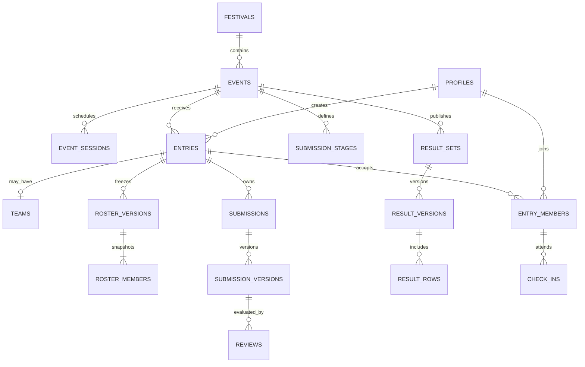

# Noesis 2.0 — Relational Database Specification

Version: 0.1 proposed contract · 10 November 2026  
Database: Supabase-managed PostgreSQL; exact supported version to be pinned at implementation.  
Status: logical/physical design; illustrative SQL is not a migration and has not been executed.

Read with [SYSTEM_ARCHITECTURE.md](SYSTEM_ARCHITECTURE.md), [API_SPECIFICATION.md](API_SPECIFICATION.md), and [AUTH_AND_RBAC.md](AUTH_AND_RBAC.md). Business decision IDs `DEC-*` and test families in the architecture remain authoritative.

## 1. Conventions and database boundary

- `app`: non-exposed domain tables, with RLS enabled. `private`: non-exposed security helpers, worker state, audit and privileged command implementations. `api`: the only exposed application schema; narrow RPC wrappers, no raw business tables.
- All entity IDs are UUIDs generated server-side unless a natural/composite key is explicitly specified. `auth.users.id` is an external managed FK, never a duplicate password store. Public participant/entry codes are separate opaque lookup identifiers and never authorization credentials.
- Unless a row is immutable, common columns are `id uuid PK`, `created_at timestamptz`, `updated_at timestamptz`, `revision bigint NOT NULL DEFAULT 1`. Actor/time/revision fields are server-controlled. Immutable rows use `id`, `created_at`, and explicit actor/source fields; corrections append rows.
- `!` below means NOT NULL; `?` nullable; `→` means FK. All listed IDs ending `_id` reference the correspondingly named entity unless explicitly external. Implement actual FKs, not naming conventions alone.
- Festival-owned domain rows carry `festival_id!`; event-scoped rows additionally carry `event_id!`. Global identity/reference tables (`profiles`, `participant_contacts`, `colleges`, permission/role definitions) are explicit exceptions and are shared across editions. Enforce scope using composite FKs to parent `(festival_id,id)` or `(festival_id,event_id,id)` unique keys. A valid UUID from a different event must not attach successfully.
- Instants use `timestamptz`. Festival days use local `date` plus IANA timezone. Windows are half-open `[opens_at,closes_at)` with `opens_at < closes_at`. Deadline commands compare `clock_timestamp()` after required lock acquisition. No implicit end-of-day interpretation for unresolved dates.
- Monetary/virtual values use exact `numeric(18,2)`; quantities use bounded `bigint`. Reject non-finite numeric values, excessive scale, overflow, negative balances where prohibited, and unsafe conversion to JavaScript Number. API decimals and bigint quantities are strings.
- Use bounded text, explicit length validation, normalized lookup columns, and checks/reference tables for states. JSONB is allowed for versioned rule/form payloads, external provenance, and redacted audit data, not for relational membership or accounting.
- `ON DELETE RESTRICT` is the default for operational history. Account removal anonymizes approved profile fields without cascading away scores, consent, ledger or audit. Retention policy is DEC-18; do not select legal retention periods in code.
- No mutable table has general client DML privileges. Command functions control business writes. Narrow invoker read RPCs have required SELECT grants and RLS. See RBAC for the intentional definer boundary.

Type conventions for the compact dictionary: entity-reference `*_id` is UUID unless explicitly an external provider/game identifier; `*_at` is timestamptz; `version_no`, ordinals, attempts, duration seconds, counts/capacities and points use bounded integer types; revisions/sequences use bigint; flags use boolean; states/kinds/codes use bounded text with CHECK/reference constraints; descriptive text uses text with maximum lengths. Hashes are validated fixed-length SHA-256 encodings; token hashes are never raw tokens. Foreign game IDs/IGNs/handles are text to preserve leading zeros and provider semantics. Values described as JSONB/arrays/numeric override these conventions. Migration work must resolve every remaining optional business field against its approved schema rather than infer requirements from column names.

## 2. Relationship overview



The diagram is a conceptual subset. Detailed definitions below include scope keys, snapshots, approvals, queues and conditional modules.

## 3. Festival, content, rules, and identity

All tables in this section are in `app` except managed Auth tables.

| Table | Required data beyond common columns | Constraints / notes |
|---|---|---|
| `festivals` | `slug!`, `name!`, `timezone!`, `starts_on! date`, `ends_on! date`, `status!` | UQ slug; valid date order; initially Asia/Kolkata and provisional dates |
| `festival_days` | `festival_id!`, `local_date!`, `label!`, `ordinal!` | UQ festival/date and festival/ordinal; no auto-inference from UTC date |
| `venues` | `festival_id!`, `name!`, `capacity?`, `handover_buffer_minutes!` | Nonnegative approved capacity/buffer; nullable capacity means unknown, not unlimited |
| `events` | `festival_id!`, `slug!`, `name!`, `category!`, `entry_mode!`, `status!`, `current_rule_version_id?`, `registration_opens_at?`, `registration_closes_at?` | UQ festival/slug; entry mode individual/team/information; no confirmation for information-only event |
| `event_sessions` | `event_id!`, `festival_day_id!`, `kind!`, `starts_at!`, `ends_at!`, `publication_status!` | Valid interval; kind reporting/contest/break/judging/awards/show; explicit cross-midnight support |
| `session_venues` | `event_session_id!`, `venue_id!`, `occupancy_units?` | Composite PK session/venue; venue/event same festival; capacity approval before publishing |
| `event_rule_versions` | `event_id!`, `version_no!`, `rules! jsonb`, `form_schema! jsonb`, `state!`, `proposed_by!`, `approved_by?`, `approved_at?`, `effective_at?` | UQ event/version; validated schema; approved versions immutable; ties/rounding explicit |
| `decisions` | `festival_id!`, `code!`, `event_id?`, `question!`, `owner_profile_id?`, `state!`, `due_at?` | UQ festival/code; DEC-01…20 seed proposals, not approvals |
| `decision_versions` | `decision_id!`, `version_no!`, `proposed_value! jsonb`, `proposed_by!`, `approved_by?`, `approved_at?`, `reason?` | Immutable revisions; decision/event-rule references retained |
| `feature_approvals` | `festival_id!`, `event_id?`, `feature_key!`, `decision_version_id!`, `enabled!`, `effective_at!` | One effective version per scope/key; command validates dependency approvals |
| `announcements` | `festival_id!`, `event_id?`, `audience!`, `title!`, `body!`, `published_at?`, `expires_at?` | Sanitized content; finalist logistics private to eligible recipients |
| `profiles` | `auth_user_id? → auth.users`, `participant_code!`, `display_name!`, `college_id?`, `status!` | UQ auth_user_id when non-null; UQ participant_code; one verified Auth user per active profile |
| `participant_contacts` | `profile_id!`, `email!`, `phone!`, `verified_email_at?`, `contact_revision!` | PK profile_id; private fields; email reflects verified identity changes; no public profile joins |
| `colleges` | `name!`, `normalized_name!`, `status!` | Staff-curated merges; no account merge based on college/name |
| `consent_versions` | `festival_id!`, `event_id?`, `purpose!`, `version_no!`, `text!`, `effective_at!`, `required!` | Immutable published text; distinct rule/privacy/public-display consent where required |
| `consent_acceptances` | `profile_id!`, `consent_version_id!`, `entry_id?`, `accepted_at!`, `source!` | Immutable; UQ profile/consent/entry using deliberate null semantics; no captain accepting for others |

An anonymized profile may have null `auth_user_id`; live participation commands require an active verified link. A changed contact/college must not silently replace event eligibility evidence captured at confirmation. Store only necessary snapshots privately.

## 4. Registration, capacity, teams, and attribution

| Table | Data | Constraints / notes |
|---|---|---|
| `entries` | `event_id!`, `owner_profile_id!`, `kind!`, `registration_code!`, `state!`, `rule_version_id!`, `submitted_at?`, `confirmed_at?`, `withdrawn_at?`, `current_roster_version_id?` | UQ registration_code; matching event entry mode; state transitions only through commands |
| `teams` | `entry_id!`, `name!`, `captain_profile_id!` | PK entry_id; team belongs to exactly one entry/event; captain must be an accepted active member for submitted/confirmed state |
| `entry_members` | `entry_id!`, `event_id!`, `profile_id!`, `member_role!`, `accepted_at!`, `released_at?`, `consent_acceptance_id!` | UQ active `(event_id,profile_id)` via partial index; own record for individual entrant; active/substitute roles distinct |
| `team_invitations` | `entry_id!`, `invited_by!`, `recipient_identity_hash!`, `token_hash!`, `member_role!`, `expires_at!`, `state!`, `accepted_by?` | UQ token_hash; raw token never persisted/logged; no accepted member until verified acceptance command |
| `roster_versions` | `entry_id!`, `version_no!`, `reason!`, `locked_by!`, `locked_at!`, `rule_version_id!`, `supersedes_id?` | Immutable; UQ entry/version; at most one current pointer in entries |
| `roster_members` | `roster_version_id!`, `profile_id!`, `entry_member_id!`, `role!`, `display_name_snapshot!`, `eligibility_snapshot! jsonb` | UQ roster/profile; snapshot source consent/college/approved player details; contact snapshots excluded unless necessary |
| `roster_change_requests` | `entry_id!`, `requested_by!`, `base_roster_version_id!`, `change! jsonb`, `state!`, `reviewed_by?`, `reason!` | Approval creates new roster version after membership/capacity/consent checks; never edit old snapshot |
| `captain_transfer_requests` | `entry_id!`, `from_profile_id!`, `to_profile_id!`, `base_roster_version_id?`, `expires_at!`, `state!`, `accepted_at?`, `reason!` | Successor must personally accept while an active member; transfer command references this acceptance and checks roster-lock policy |
| `capacity_pools` | `event_id!`, `purpose!`, `unit!`, `approved_limit!`, `allocated_units!`, `rule_version_id!` | UQ event/purpose; purpose registration/finalists/admissions; `0 <= allocated_units <= approved_limit`; null limit not permitted in active pool |
| `capacity_allocations` | `pool_id!`, `entry_id!`, `units!`, `allocated_at!`, `released_at?`, `source_command_id!` | Units > 0; UQ live pool/entry; pool counter and rows update atomically |
| `entry_status_events` | `entry_id!`, `from_state?`, `to_state!`, `actor_id!`, `reason?`, `command_id!` | Immutable transition history; no client-written actor |
| `schedule_exceptions` | `profile_id!`, `entry_id!`, `conflicting_session_ids! uuid[]`, `rule_version_id!`, `approved_by!`, `reason!` | UUID array only an immutable evidence snapshot; normalized sessions remain authoritative; no unapproved override |
| `campaign_sources` | `festival_id!`, `code!`, `kind!`, `college_id?`, `owner_profile_id?`, `state!` | UQ festival/code; kinds campaign/college/ambassador/creator; approved values only |
| `entry_attributions` | `entry_id!`, `source_id?`, `source_code_snapshot?`, `kind_snapshot!`, `captured_at!`, `policy_version!`, `unrecognized_code_hash?` | One canonical attribution per entry; unknown/missing Unattributed; proposed first approved source, organizer may amend policy |
| `event_player_details` | `entry_member_id!`, `platform?`, `gamer_tag?`, `game_player_id?`, `ign?`, `codeforces_handle?`, `leetcode_handle?`, `verified_at?` | PK member; event-specific required fields checked at submit; normalized handle uniqueness only if approved |
| `entry_form_answers` | `entry_id!`, `rule_version_id!`, `answers! jsonb` | PK entry; validated against approved bounded extra-field schema; no status/payment/role inside answers |

Individuals may be invited to multiple teams but can accept only one active membership per event. A person may participate in different events. Team names are not identities. Re-registration after withdrawal reuses the entry under an approved reopen command or creates a new attempt only after prior membership/allocation release; historical entries remain queryable.

### 4.1 Illustrative constraint patterns

```sql
-- Pattern only; tables and dependency migrations must be created first.
create unique index entry_members_one_active_event_person
  on app.entry_members (event_id, profile_id)
  where released_at is null;

create unique index check_ins_one_person_event_day
  on app.check_ins (festival_id, event_id, festival_day_id, profile_id);

create unique index capacity_one_live_entry
  on app.capacity_allocations (pool_id, entry_id)
  where released_at is null;

-- A parent scope key must exist before adding this composite foreign key.
alter table app.entries
  add constraint entries_scope_unique unique (festival_id, event_id, id);
```

Do not use a CHECK containing a cross-table query for roster cardinality/capacity. Use locked commands and, for critical invariants, deferred constraint triggers. A DB CHECK handles local values; it cannot safely enforce aggregate membership under concurrency. See [PostgreSQL constraints](https://www.postgresql.org/docs/current/ddl-constraints.html).

## 5. Submissions, assets, reviews, and selection

| Table | Data | Constraints / notes |
|---|---|---|
| `submission_stages` | `event_id!`, `code!`, `opens_at?`, `closes_at?`, `required_fields! jsonb`, `rule_version_id!`, `state!` | UQ event/code; stages online_solution/final_project/dance_video/dance_audio/bug_stage/feature_stage |
| `submissions` | `entry_id!`, `stage_id!`, `draft! jsonb`, `current_version_id?`, `frozen_version_id?`, `state!` | UQ entry/stage; draft updates use revision; final pointers scoped to same submission |
| `submission_versions` | `submission_id!`, `version_no!`, `submitted_by!`, `submitted_at!`, `payload! jsonb`, `manifest_id?`, `source_revision!` | Immutable; UQ submission/version; values validated for stage; frozen version cannot be replaced silently |
| `upload_intents` | `festival_id!`, `event_id?`, `entry_id?`, `stage_id?`, `actor_id!`, `purpose!`, `bucket!`, `object_path!`, `expected_mime!`, `maximum_bytes!`, `expires_at!`, `state!` | Participant intents require entry/stage; staff imports/evidence use explicit authorized event/purpose; server paths and one object per intent; no overwrite of submitted assets |
| `assets` | `upload_intent_id?`, `source_job_id?`, `bucket!`, `object_path!`, `byte_size!`, `detected_mime!`, `sha256!`, `scan_state!`, `verified_at?` | Exactly one intent or controlled generation job source; immutable finalized bytes; UQ bucket/path; quarantined files unavailable to judges/AV |
| `submission_assets` | `submission_version_id!`, `asset_id!`, `purpose!` | UQ version/purpose/asset; explicit code/video/audio/evidence roles |
| `artifact_manifests` | `entry_id!`, `stage_id!`, `state!`, `repository_url?`, `commit_sha?`, `archive_asset_id?`, `video_asset_id?`, `external_access_status!`, `frozen_at?`, `manifest_hash?` | Frozen manifest immutable; required stage assets/hash/access must be ready before final receipt |
| `external_link_checks` | `manifest_id!`, `url_hash!`, `checked_at!`, `status!`, `checker_version!`, `safe_error_code?` | No secrets in logs; private URL fetching subject to SSRF restrictions |
| `rubric_versions` | `event_id!`, `code!`, `version_no!`, `criteria! jsonb`, `state!`, `approved_by?` | Criteria weights/ranges and calculation method validated; approved immutable |
| `review_assignments` | `submission_version_id!`, `reviewer_id!`, `rubric_version_id!`, `state!`, `assigned_by!`, `conflict_declared_at?` | UQ version/reviewer/rubric; access to assigned version only |
| `reviews` | `assignment_id!`, `score_details! jsonb`, `total! numeric`, `private_notes?`, `performer_feedback?`, `state!`, `submitted_at?` | One current review per assignment; audited review revisions; range/total checked server-side |
| `review_revisions` | `review_id!`, `revision_no!`, `score_details!`, `total!`, `reason!`, `actor_id!` | Immutable audit of reviewer changes; previous score not overwritten without history |
| `selection_batches` | `event_id!`, `rule_version_id!`, `source_manifest_hash!`, `state!`, `approved_by?`, `approved_at?` | Immutable approved selection inputs and order; no stale-version review permitted |
| `selection_decisions` | `batch_id!`, `entry_id!`, `submission_version_id!`, `decision!`, `reserve_rank?`, `reason?` | UQ batch/entry; selected/reserve/not_selected; unique reserve rank per batch |
| `finalist_confirmations` | `entry_id!`, `selection_decision_id!`, `state!`, `responded_at?`, `expires_at!`, `decision_actor_id?` | Confirm/decline/expire separately; promotion creates new selection decision/history, not a score rewrite |

Roster lock and final project freeze are different operations. A newer online solution makes earlier reviews inapplicable to the new selection batch, but does not delete them. Submission close is enforced synchronously even if the freeze worker is delayed. Initiating an upload before cutoff is not a successful submission; all required assets/manifests must be ready when finalized, unless an explicit approved exception policy exists.

## 6. Challenges and event effects

| Table | Data | Constraints / notes |
|---|---|---|
| `challenge_types` | `festival_id!`, `code!`, `rule_version_id!`, `evaluator_version!`, `state!` | Four approved types; evaluator tests required |
| `challenge_variants` | `type_id!`, `version_no!`, `public_prompt!`, `answer_rule_id!` | Immutable approved question version; answer rules stored in private table below |
| `challenge_waves` | `event_id!`, `ordinal!`, `release_at!`, `closes_at!`, `attempt_limit!`, `rule_version_id!`, `state!` | UQ event/ordinal; four waves; positive attempts and valid interval |
| `challenge_assignments` | `wave_id!`, `entry_id!`, `variant_id!`, `captain_profile_id!`, `revealed_at?`, `attempts_used!` | UQ wave/entry; persisted assignment; selected locked roster required; attempts bounded |
| `challenge_attempts` | `assignment_id!`, `attempt_no!`, `actor_id!`, `answer! jsonb`, `evaluated_at!`, `outcome!`, `evaluator_version!`, `command_id!` | Immutable; UQ assignment/attempt_no and command; answers private to actor/authorized marshal |
| `effect_definitions` | `event_id!`, `code!`, `rule_version_id!`, `kind!`, `duration_seconds?`, `parameters! jsonb` | Approved allowlisted capabilities only; protected capabilities prohibited |
| `effect_activations` | `effect_definition_id!`, `source_kind!`, `source_key!`, `approved_by?`, `starts_at!`, `expires_at?` | UQ source_kind/source_key/effect; source answer or marshal-approved transition |
| `effect_recipients` | `activation_id!`, `entry_id!`, `applied_at!`, `source_roster_version_id?` | UQ activation/entry; freeze recipients for bulk transition |
| `effect_reversals` | `effect_recipient_id!`, `actor_id!`, `reason!`, `reversed_at!`, `command_id!` | One effective reversal per recipient; immutable; no DELETE of applied effect |

`private.challenge_answer_rules(type_id, version_no, encrypted_or_hashed_rule, evaluator_config)` is never granted to participant read RPCs or Storage. Hashing is suitable only for sufficiently strong exact answers; do not claim low-entropy answer hashes are secret if exposed.

## 7. Competition rounds, sports, and Override

| Table | Data | Constraints / notes |
|---|---|---|
| `competition_stages` | `event_id!`, `code!`, `ordinal!`, `rule_version_id!`, `starts_at?`, `ends_at?`, `state!`, `locked_roster_version_policy!` | UQ event/code and event/ordinal; duration/advance policy approved |
| `rounds` | `stage_id!`, `ordinal!`, `question_count?`, `duration_seconds?`, `state!`, `started_at?`, `closes_at?` | UQ stage/ordinal; server times and approved rules; null pending duration blocks start |
| `contest_integrations` | `event_id!`, `provider!`, `external_contest_id!`, `settings_version!`, `capabilities! jsonb`, `verified_at?` | Secrets in private store/Vault; capabilities include proven Blackout controls |
| `score_imports` | `stage_id!`, `source_asset_id!`, `provider!`, `source_digest!`, `state!`, `verified_by?` | UQ stage/source_digest; raw rows retained; unknown entrants quarantined |
| `stage_scores` | `stage_id!`, `entry_id!`, `source_import_id?`, `score! numeric`, `details! jsonb`, `state!`, `score_version!` | Versioned approved scores, not final public placements |
| `matches` | `round_id!`, `external_code?`, `station_id?`, `slot_starts_at?`, `slot_ends_at?`, `best_of?`, `state!`, `current_result_id?` | Rules constrain game count; station slot conflicts checked under station lock |
| `match_entries` | `match_id!`, `entry_id!`, `slot!`, `source_roster_version_id!` | UQ match/slot and match/entry; same event; explicit bye/no-show outcomes |
| `match_result_versions` | `match_id!`, `version_no!`, `winner_entry_id?`, `outcome!`, `scores! jsonb`, `evidence_asset_id?`, `verified_by!`, `reason?` | Immutable; UQ match/version; winner must be match entrant; draw permitted only by rule |
| `bracket_edges` | `source_match_id!`, `outcome_slot!`, `target_match_id!`, `target_slot!` | UQ target/slot; same event; acyclic and one advancement per edge |
| `stations` | `event_id!`, `name!`, `settings! jsonb`, `state!` | Approved FIFA edition/settings/station inventory |
| `lobbies` | `stage_id!`, `ordinal!`, `map_code!`, `capacity!`, `access_opens_at!`, `access_closes_at!`, `state!` | Six qualifier match records; final count from locked policy |
| `lobby_entries` | `lobby_id!`, `entry_id!`, `slot!`, `roster_version_id!` | UQ lobby/slot and lobby/entry; no over-cap roster |
| `bgmi_score_rows` | `lobby_id!`, `entry_id!`, `version_no!`, `placement!`, `eliminations!`, `evidence_asset_id!`, `state!`, `verified_by?` | Positive placement/nonnegative eliminations; verified placement unique in lobby unless rule explicitly supports shared ranks |
| `bug_issues` | `event_id!`, `code!`, `approved_points!`, `reference_evidence_asset_id?` | UQ event/code; mentor reference fixes private |
| `bug_reports` | `entry_id!`, `stage_id!`, `issue_id!`, `reproduction!`, `evidence_asset_id!`, `fix_manifest_id!`, `state!`, `duplicate_of_id?`, `verdict_by?` | Duplicate policy version stored; fixed commit frozen at cutoff |
| `feature_checks` | `stage_id!`, `rubric_version_id!`, `code!`, `points!`, `acceptance_text!` | UQ stage/code; reviewed completion tied to submission version through review criteria |

`private.lobby_credentials(lobby_id PK, secret_reference!, revision!, rotated_at!)` stores encrypted credentials or a Vault reference. Only the credential-read command may return current values after membership/window checks. Never include them in generic lobby JSON or broadcast payloads.

Chess pairings use rounds/matches/match_entries; referee-approved draw/tie-break details are structured in rule versions and result evidence. Do not implement Chess/FIFA/BGMI gameplay engines.

## 8. Virtual market and accounting

All market records scope to `market_sessions`, an event-linked game instance. Money here is fictional and cannot authorize real payments.

| Table | Data | Constraints / notes |
|---|---|---|
| `market_sessions` | `event_id!`, `state!`, `opens_at!`, `closes_at!`, `opening_cash!`, `current_price_version_id?`, `closing_price_version_id?`, `closed_at?`, `close_ledger_sequence?` | One active session per event; approved starting funds immutable once issued |
| `market_players` | `market_session_id!`, `entry_id!`, `verified_by!`, `verified_at!` | UQ session/entry; onsite verification required |
| `market_wallets` | `market_player_id!`, `cash! numeric(18,2)` | UQ player; nonnegative finite cash; changes only with corresponding ledger transaction |
| `market_instruments` | `market_session_id!`, `symbol!`, `name!`, `state!` | UQ session/symbol; approved tradable universe |
| `market_price_versions` | `market_session_id!`, `version_no!`, `published_at!`, `published_by!`, `news!` | Immutable full price set; UQ session/version; current pointer changes once all quotes exist |
| `market_quotes` | `price_version_id!`, `instrument_id!`, `price! numeric(18,2)` | UQ version/instrument; positive finite price; same session |
| `market_holdings` | `wallet_id!`, `instrument_id!`, `quantity! bigint` | Composite PK; nonnegative quantity; reconcile to executions |
| `market_orders` | `wallet_id!`, `instrument_id!`, `side!`, `quantity!`, `price_version_id!`, `state!`, `command_id!`, `accepted_at!` | Quantity > 0; one immediate execution for accepted order; no pending exchange/order book in v1 |
| `market_trades` | `order_id!`, `execution_price!`, `quantity!`, `gross_value!`, `ledger_transaction_id!`, `executed_at!` | UQ order; immutable; exact multiplication within range; source quote retained |
| `market_ledger_transactions` | `market_session_id!`, `sequence! bigint`, `source_type!`, `source_id!`, `posted_at!` | UQ session/sequence and source_type/source_id; immutable opening/buy/sell/reversal transaction |
| `market_ledger_lines` | `transaction_id!`, `account_code!`, `wallet_id?`, `amount! numeric(18,2)` | Signed exact amounts; deferred trigger requires at least two valid lines and sum(amount)=0 per transaction; system counterparty account included |
| `market_valuations` | `market_session_id!`, `wallet_id!`, `closing_price_version_id!`, `ledger_sequence!`, `cash!`, `stock_value!`, `total!`, `rank?`, `rule_version_id!` | UQ session/wallet; immutable finalized snapshot; total=cash+stock_value; ranks require approved ties |

Use append-only reversing entries for audited corrections, not deletion of trades. Holdings are quantity records reconciled to orders; cash uses the balanced ledger plus a locked cached wallet balance. Do not infer holdings from cash lines. Opening issuance debits system opening funds and credits player cash exactly once; buys/sells balance against system settlement.

No fees, shorts, margin, fractional shares or real-time external financial feed are implied. Introducing any requires a revised rule and schema. An accepted order executes synchronously; client-requested stale quote versions return a conflict rather than silently executing at a new price.

## 9. Results, disputes, Cup, and stage

| Table | Data | Constraints / notes |
|---|---|---|
| `result_sets` | `event_id!`, `category_code!`, `published_version_id?` | UQ event/category; one authoritative published pointer |
| `result_versions` | `result_set_id!`, `version_no!`, `state!`, `source_digest!`, `rule_version_id!`, `created_by!`, `approved_by?`, `approved_at?`, `published_at?`, `supersedes_id?`, `correction_reason?` | Immutable content once approval requested; approval/publication metadata transitions audited |
| `result_rows` | `result_version_id!`, `entry_id!`, `roster_version_id!`, `score!`, `placement!`, `prize_category?`, `proof_asset_id?`, `source_stage_score_ids! uuid[]` | UQ version/entry/prize_category with explicit null handling; placements/ties from rule; source array is immutable provenance only |
| `public_result_rows` | `result_version_id!`, `event_id!`, `entry_id!`, `public_name!`, `team_name?`, `placement!`, `score_display!`, `prize_category?`, `published_at!` | Separate sanitized projection; anon SELECT RLS only for current published pointer; no contact/note columns |
| `disputes` | `entry_id!`, `result_version_id!`, `submitted_by!`, `reason!`, `evidence_asset_id?`, `state!`, `reviewer_id?`, `outcome?`, `resolved_at?` | Cutoff enforced; one open dispute per entry/result unless policy permits more |
| `stage_handoffs` | `festival_id!`, `result_version_id?`, `performance_package_id?`, `package_asset_id!`, `manifest_hash!`, `recipient_role!`, `state!`, `acknowledged_by?`, `acknowledged_at?`, `supersedes_id?` | At least one result/performance reference; approved content only; correction requires replacement/ack |
| `cup_squads` | `festival_id!`, `name!`, `captain_profile_id!`, `state!`, `locked_at?` | Disabled without feature approval; unrelated to event teams |
| `cup_invitations` | `squad_id!`, `invited_by!`, `recipient_identity_hash!`, `token_hash!`, `expires_at!`, `state!`, `accepted_by?` | Purpose-specific hashed token; UQ token_hash; separate from event invitations and personal affiliation consent |
| `cup_memberships` | `squad_id!`, `profile_id!`, `accepted_at!`, `released_at?`, `consent_acceptance_id!` | UQ active festival/profile; independent consent and lock policy |
| `cup_affiliation_locks` | `festival_id!`, `policy_version_id!`, `locked_at!`, `locked_by!`, `manifest_hash!` | Immutable approved affiliation-lock batch; one effective batch referenced by calculations |
| `cup_affiliation_snapshots` | `lock_id!`, `squad_id!`, `profile_id!`, `membership_id!` | UQ lock/profile; immutable consenting membership snapshot independent of later account/team changes |
| `cup_policy_versions` | `festival_id!`, `version_no!`, `event_weights! jsonb`, `eligibility_rules! jsonb`, `tie_rules! jsonb`, `approved_by!`, `effective_at!` | Immutable approved policy; event references validated |
| `cup_calculation_batches` | `festival_id!`, `policy_version_id!`, `affiliation_lock_id!`, `source_results_digest!`, `state!`, `published_at?` | Versioned complete recomputation over fixed affiliations; previous batch retained |
| `cup_event_points` | `batch_id!`, `squad_id!`, `event_id!`, `winning_result_row_id?`, `points!`, `reason!` | UQ batch/squad/event; best valid finish once; membership snapshot at affiliation lock |

Publishing locks the result set, validates all inputs/permissions, inserts sanitized projection, changes the current pointer, records audit/outbox, and commits together. Corrections do not mutate old rows. An approved snapshot remains historical but only the current pointer is public. A stale cached stage package must prominently identify its source version and superseded state.

## 10. Attendance, passes, performers, and Arcade

| Table | Data | Constraints / notes |
|---|---|---|
| `check_ins` | `profile_id!`, `entry_member_id!`, `entry_id!`, `event_id!`, `festival_day_id!`, `observed_at!`, `received_at!`, `staff_id!`, `source!`, `offline_operation_id?`, `exception_id?` | UQ person/event/day; entry_member must belong to same person/entry/event; original observation vs server receipt separate |
| `roster_verifications` | `entry_id!`, `roster_version_id!`, `verified_by!`, `verified_at!`, `kind!` | Separate captain/roster checks; never bulk creates person attendance |
| `desk_exceptions` | `event_id!`, `profile_id!`, `entry_id?`, `kind!`, `reason!`, `evidence_asset_id?`, `approved_by!`, `expires_at?` | Policy allowlist; cannot invent eligibility/payment approval without corresponding authority |
| `offline_roster_exports` | `event_id!`, `festival_day_id!`, `device_id!`, `export_asset_id!`, `manifest_hash!`, `expires_at!`, `generated_by!`, `rules_revision!` | Private minimal export; encrypted device storage; revocation/removal procedures |
| `offline_import_batches` | `export_id!`, `device_id!`, `submitted_by!`, `file_digest!`, `state!` | UQ export/file_digest; authorized reconciliation required |
| `offline_observations` | `batch_id!`, `operation_id!`, `profile_id!`, `entry_id!`, `observed_at!`, `outcome!`, `check_in_id?`, `conflict_reason?` | UQ device/operation via scoped device relation; retain duplicate/conflict evidence without duplicate attendance |
| `passes` | `festival_id!`, `holder_name!`, `holder_profile_id?`, `kind!`, `token_hash!`, `state!`, `approved_by!`, `valid_from!`, `valid_until!` | Guest/creator admission identity distinct from participant profile; UQ token_hash |
| `pass_entitlements` | `pass_id!`, `event_id!`, `festival_day_id!`, `quantity!`, `used_quantity!`, `reentry_policy!` | UQ pass/event/day; bounded use under lock; no competition entry |
| `pass_uses` | `entitlement_id!`, `quantity!`, `staff_id!`, `used_at!`, `command_id!` | Immutable; positive quantity; no online duplicate consumption |
| `performances` | `entry_id!`, `format!`, `title!`, `review_state!`, `current_video_version_id?`, `current_audio_version_id?` | PK entry; approved solo/group rules; use shared submissions for media |
| `performance_reviews` | `performance_entry_id!`, `submission_version_id!`, `reviewer_id!`, `state!`, `private_feedback!` | Tracks Pending/Changes needed/Approved; version-specific |
| `stage_slots` | `event_session_id!`, `performance_entry_id!`, `order_no!`, `cue_code!`, `audio_version_id!`, `roster_version_id!`, `state!` | UQ session/order and cue; audio receipt required; order approved |
| `performance_packages` | `event_id!`, `version_no!`, `asset_id!`, `manifest_hash!`, `state!` | Immutable offline bundle, cue sheet and exact audio versions |
| `playback_checks` | `package_id!`, `stage_slot_id!`, `device_role!`, `checked_by!`, `checked_at!`, `outcome!` | Main and backup checks; new package/audio invalidates applicability |
| `arcade_coupons` | `event_id!`, `code_hash!`, `price!`, `payment_state!`, `state!`, `issued_by!`, `issued_at!`, `payment_record_id?` | UQ code_hash; approved feature/price; one terminal redemption/refund path under policy |
| `coupon_redemptions` | `coupon_id!`, `redeemed_by!`, `redeemed_at!`, `command_id!` | UQ coupon and command; immutable |
| `prize_items` | `event_id!`, `sku!`, `name!`, `stock_on_hand!` | UQ event/sku; nonnegative cached stock |
| `prize_movements` | `prize_item_id!`, `quantity_delta!`, `kind!`, `coupon_redemption_id?`, `reason!`, `actor_id!` | Immutable opening/issue/return/adjustment; no negative total stock; controlled explicit return |
| `coupon_adjustments` | `coupon_id!`, `kind!`, `reason!`, `actor_id!`, `refund_record_id?` | Immutable void/refund approval; no automatic prize restock |

Pass usage totals remain separate from unique verified festival participants; unnamed multi-person passes cannot truthfully produce a unique-person metric. Avoid double-counting a linked participant/pass holder. Offline exceptions and pass quantity enforcement need explicit DEC-20 policy before offline admission support.

## 11. Conditional payment records and operational infrastructure

| Table / schema | Data | Constraints / notes |
|---|---|---|
| `app.fee_policy_versions` | `event_id!`, `version_no!`, `amount!`, `currency!`, `refund_policy! jsonb`, `approved_by!` | Immutable; absent/disabled policy means no collection |
| `app.payment_records` | `entry_id?`, `coupon_id?`, `policy_version_id!`, `provider?`, `external_payment_id?`, `amount!`, `currency!`, `state!`, `verified_by?`, `verified_at?`, `proof_asset_id?` | Exactly one payable entry/coupon; UQ provider/external ID when present; server/provider facts plus required staff verification |
| `app.refund_records` | `payment_record_id!`, `amount!`, `reason!`, `state!`, `approved_by!`, `external_refund_id?` | Total successful/pending reserved refunds bounded by verified payment; provider retries deduplicated |
| `private.webhook_events` | `provider!`, `external_event_id!`, `payload_digest!`, `verified_at!`, `state!`, `received_at!` | UQ provider/event; raw payload retention minimized; signature verified before trusted processing |
| `private.command_receipts` | `actor_key!`, `operation!`, `idempotency_key!`, `request_hash!`, `resource_id?`, `safe_response! jsonb`, `completed_at!` | UQ actor/operation/key; immutable replay receipt; no signed URLs/contacts/credentials in stored response |
| `private.command_budgets` | `actor_key!`, `operation!`, `window_start!`, `used_count!`, `limit!` | UQ actor/operation/window; DB command quotas complement gateway rate limits |
| `private.scheduled_jobs` | `job_type!`, `source_key!`, `due_at!`, `state!`, `lease_until?`, `worker_id?`, `attempts!`, `last_error_code?` | UQ job_type/source_key; ready/leased/completed/dead_letter; retry leases expire |
| `private.outbox_messages` | `aggregate_type!`, `aggregate_id!`, `event_type!`, `source_revision!`, `recipient_id?`, `payload! jsonb`, `available_at!`, `state!`, `lease_until?` | UQ aggregate/event/revision/recipient with explicit null semantics; redacted template inputs |
| `private.delivery_attempts` | `outbox_id!`, `attempt_no!`, `provider_message_id?`, `state!`, `attempted_at!`, `error_code?` | UQ message/attempt; delivery webhook maps securely |
| `app.notifications` | `recipient_profile_id!`, `event_id?`, `type!`, `safe_body!`, `source_id!`, `read_at?` | User-visible durable next steps; no email failure changes business state |
| `app.export_jobs` | `event_id?`, `requested_by!`, `kind!`, `filters! jsonb`, `state!`, `asset_id?`, `expires_at!`, `manifest_hash?` | Recheck scope before generation AND download; minimal authorized columns |
| `private.audit_events` | `occurred_at!`, `actor_id?`, `actor_kind!`, `session_id?`, `request_id!`, `command_id?`, `action!`, `resource_type!`, `resource_id?`, `event_id?`, `before_safe?`, `after_safe?`, `reason?` | Append-only for application roles; no tokens, answers, credentials or unredacted contacts |

Role, permission, assignment, service-principal, access-state and judge-conflict tables are fully specified in [AUTH_AND_RBAC.md](AUTH_AND_RBAC.md#4-authorization-data-model). They are part of this schema contract; do not implement authorization as arbitrary JSON in profiles.

## 12. Transaction algorithms and locking

### 12.0 State vocabulary and transition restrictions

Use checked text/reference values and explicit transition commands. The following is the proposed vocabulary for persisted states; business-dependent transitions remain gated by DEC approvals. Do not accept arbitrary state strings through generic PATCH endpoints.

| Aggregate | Vocabulary / allowed lifecycle |
|---|---|
| Event/content | draft → published → archived; cancellation retains history and triggers participant notices |
| Rule/rubric/decision version | draft → pending_approval → approved or rejected; approved content immutable, superseded by another version |
| Entry | draft → submitted → confirmed/waitlisted/rejected; permitted submitted/waitlisted/confirmed → withdrawn/cancelled; reopen is explicit |
| Invitation/transfer | pending → accepted/declined/revoked/expired; accepted transfer request may become applied once |
| Submission | draft → submitted → frozen; each submit appends a version; review applicability separate |
| Upload intent/asset | issued → uploaded → inspecting → ready or rejected; expired intents do not grant upload/finalize; immutable ready asset cannot revert through client action |
| Review | draft → submitted; revision/correction audited; conflicted/revoked assignment blocks further writes |
| Finalist confirmation | pending → confirmed/declined/expired; reserve promotion creates a new source decision |
| Round/stage | configured → ready → running → closed → reviewed; pending rules block ready/running; cancellation/restart requires explicit policy |
| Market | configured → open ↔ paused → closed → valued; actual close time overrides stale open state; no ordinary reopen after close |
| Match result / BGMI score | provisional → verified → incorporated; correction creates a version and checks downstream impact |
| Result/Cup batch | draft → pending_approval → approved → published → superseded; published content is immutable |
| Performer review | pending → changes_needed/approved; new required media creates a new pending review |
| Coupon | issued → redeemed/voided/refund_pending; refund_pending → refunded or issued only after verified provider failure and policy check; redeemed refund only if explicitly approved |
| Payment | pending → provider_confirmed → verified_paid; failed/cancelled/disputed alternatives recorded; approved offline payment channel may skip provider_confirmed but never staff verification |
| Refund | requested → approved/reserved → submitted → succeeded/failed; uncertain provider response stays reconciling, not automatically failed/retryable as a new refund |
| Job/outbox | pending/ready → leased → completed; lease expiry → pending with retry; exhausted → dead_letter; terminal receipt prevents duplicate business effect |
| Offline observation | pending → accepted/duplicate/conflict/rejected; conflict resolution links resulting attendance/exception without erasing original evidence |
| Pass | active → expired/revoked/exhausted; entitlement quantities derive exhaustion; correction preserves usage records |

For storage inspection/scanning, long work occurs outside the transaction and final state changes compare the expected job/intent revision. For finance, provider-confirmed and staff-verified evidence must remain independently inspectable even when represented by a combined state. Payment disputes do not automatically erase historical attendance or published results; create a scoped review task.

### 12.1 General command envelope

1. Validate verified JWT identity/current access state and permission; never trust actor IDs from HTTP fields.
2. Claim an idempotency receipt scope with a unique insert. The receipt and successful business mutation commit together. A competing insert waits or returns a documented retry response; same key/different request hash conflicts. Recheck authorization even for replay.
3. Lock aggregate rows in a deterministic global order. Read current rule/version and take fresh `clock_timestamp()` after waits. Recheck authorization before commit for sensitive changes; serialize against applicable assignment/access-state revocation using compatible locks.
4. Validate state/deadline/eligibility/constraints and expected revision; apply all writes in one transaction.
5. Append audit/outbox/notification as applicable; complete safe receipt; commit.
6. External effects run after commit. Failure before commit rolls everything back; failure after commit recovers through receipt/outbox.

Do not persist successful receipts for failed validations. To retain per-command budgets on expected rejected attempts, count the budget in the outer command transaction, perform business writes inside a subtransaction, and return a structured domain failure after rolling back that subtransaction. The gateway maps that failure to HTTP status; direct RPC receives the same domain failure. Raising an uncaught exception for every expected rejection would roll back the budget too. Unexpected internal failures may roll back the entire transaction and are handled by gateway/infrastructure abuse limits. Idempotent replays do not consume another capacity/trade quota. Authenticate and rate-limit before expensive data work.

### 12.2 Capacity confirmation

Lock entry and affected membership rows in canonical ID order, then registration pool, then any additional pools in sorted order. Validate complete approved roster/consents/payment/overlap exceptions; calculate approved units server-side. Atomically increment pool only when `allocated_units + units <= approved_limit`; insert allocation and set confirmed. Withdrawal releases a live allocation once. Quota changes use the same pool lock; cannot lower limit below live allocation sum.

Because signup membership uniqueness and entry confirmation span tables, acceptance, removal, confirmation and replacement all use this same lock discipline. Concurrent accepted-member inserts rely on the partial unique index as a final guard. Snapshot cardinality is checked before committing any submitted/confirmed entry.

### 12.3 Market serialization

For v1, every order, price publication, pause, resume and close locks the same `market_sessions` row `FOR UPDATE`. Then lock wallet, instrument holdings in sorted ID order. This intentionally serializes the small game for correctness; measure throughput before optimizing.

After acquiring session lock, check actual server time, state, submitted quote version, price existence and wallet/holdings. Record order, trade, balanced cash ledger, updated wallet/holdings and receipt atomically. Close takes the same lock and freezes current prices and ledger sequence. An order queued behind close or crossing the actual deadline is rejected, even if HTTP arrived earlier. No provider/network call inside the transaction.

### 12.4 Other atomic boundaries

| Command | Locks / write set |
|---|---|
| Accept invitation | Entry + relevant member/invitation; verify recipient/expiry; insert active member once |
| Submit/freeze | Entry/submission/stage + expected revision; require ready immutable assets; insert version and freeze pointer |
| Selection/promotion | Selection batch/current source versions + finalist pool + entry; decision/allocation/confirmation/outbox together |
| Challenge answer | Assignment row; fresh window/attempt checks; insert attempt + increment + effect/outbox |
| Bulk effect | Transition activation key; recipient snapshot; unique per-entry application |
| Publish result | Result set + source versions; approve allowed source, create projection, switch pointer, supersede handoff |
| Publish venue schedule | Lock all affected venues in sorted ID order, validate occupied intervals/capacity/buffers and approved exceptions, then publish sessions atomically |
| Check-in | Eligibility records + unique person/event/day insert; duplicate returns original receipt |
| Coupon redeem | Coupon then prize rows sorted; eligibility + redemption + stock movement + receipt |
| Refund | Payment/coupon then stock if explicit return; reserve refund total and set coupon refund_pending under lock before external call; pending coupon cannot redeem |
| Pass use | Entitlement; quantity check + immutable usage + counter |
| Offline merge | Import batch; per-observation idempotency and attendance uniqueness; conflict rows retained |

Keep transactions short; bound batch size. Use `FOR UPDATE SKIP LOCKED` only to claim independent worker jobs, never to skip a locked final capacity slot or a financial row and assume success. Retry deadlock/serialization failures with bounded backoff and same command key. [PostgreSQL locking](https://www.postgresql.org/docs/current/explicit-locking.html), [transaction isolation](https://www.postgresql.org/docs/current/transaction-iso.html)

## 13. Indexes, reporting, storage lifecycle, and migrations

Index all frequently traversed foreign keys and authorization predicates. Starting indexes: entries `(event_id,state,created_at,id)`; members `(profile_id,event_id)` active; review assignments `(reviewer_id,state)`; check-ins `(event_id,festival_day_id)` plus unique person key; jobs `(due_at,id)` partial ready; outbox `(available_at,id)` partial pending; result pointer/projection lookup; orders `(wallet_id,created_at,id)`; ledger `(market_session_id,sequence)`; active role grants `(profile_id,event_id,expires_at)`.

Use keyset pagination, bounded lists, selected columns, and EXPLAIN against realistic data with real authenticated roles. RLS predicate columns must be indexed; policies must not recursively depend on themselves. Do not partition at this expected size without measured need.

Report definitions:

- Registered people: distinct profile IDs in qualifying entries, with inclusion states documented.
- Festival attendance: distinct profile IDs in accepted check-ins, not sum of daily/event rows.
- Daily attendance: distinct profile IDs per explicit festival day.
- Event attendance: distinct profile IDs per event/day; entry counts separate.
- Pass admissions: consumed quantities, separately labeled; unique people unavailable for anonymous multi-person passes.
- Arcade: coupon issue/redemption/refund/unused counts and verified monetary totals plus stock ledger reconciliation.
- Trading: ledger/holdings reconciliation; closing valuation references immutable price version and sequence.

Storage finalization is a saga: issue intent → upload to quarantine → inspect/scan/hash → mark ready → link to immutable version. Storage and PostgreSQL are not one atomic transaction. Unlinked blobs are garbage-collected only after a safe grace period; referenced frozen assets cannot be overwritten/deleted by users. A DB restore requires separate Storage object recovery and manifest reconciliation. [Storage controls](https://supabase.com/docs/guides/storage/security/access-control), [backup limitation](https://supabase.com/docs/guides/platform/backups)

Migrations must be generated with the installed CLI's supported workflow, reviewed in version control, and applied first to an empty local DB and a seeded upgrade fixture. Verify CLI target explicitly; do not assume pre-v3 flags/defaults. Check extensions against the selected PostgreSQL release. Test constraints, grants, policies and generated types before promotion. Avoid destructive production reseeding.

## 14. Database test catalog

All tests below are specified, not executed. Run against real PostgreSQL connections; include cross-event and cross-festival fixtures. Each failed command must leave no partial business records, counter drift, or public projection.

| ID | Setup / stimulus | Expected invariant |
|---|---|---|
| DB-01 | Same auth user creates profile twice concurrently | One profile/code returned; no duplicate identity |
| DB-02 | Attach child to another festival/event parent | Composite FK rejects it |
| DB-03 | Invalid local interval / cross-midnight interval | Invalid rejected; valid explicit overnight interval retained |
| DB-04 | Accept simultaneous same-event memberships | One active membership; other command conflicts |
| DB-05 | Confirm team below/above approved roster size | Constraint/command rejects and rolls back allocation |
| DB-06 | Captain absent from accepted roster | Submitted/confirmed commit rejected |
| DB-07 | Invite expiry occurs while waiting for lock | Fresh clock check rejects acceptance |
| DB-08 | Two requests claim last capacity unit | Sum allocations and counter never exceed cap |
| DB-09 | Withdraw/retry/reconfirm race | Release once; one live allocation; valid current state |
| DB-10 | Reduce cap below allocated total | Rejected; existing entries preserved |
| DB-11 | Confirmation concurrently with member removal | Either valid confirmed snapshot or removal succeeds before rejection; no invalid confirmed roster |
| DB-12 | Replace member after roster freeze | New approved version; historical roster unchanged |
| DB-13 | Reuse idempotency key same/different payload | Same receipt / explicit conflict; no duplicate effects |
| DB-14 | Commit succeeds but response lost | Retry returns original committed result |
| DB-15 | Audit/outbox insertion fails during mutation | Entire mutation rolls back |
| DB-16 | Asset upload succeeds, DB finalize fails | Blob not accepted as submission; retry/reconcile safe |
| DB-17 | Finalize intent against another entry or unscanned file | Rejected; no linked ready asset |
| DB-18 | Submit at T−1ms/T/T+1ms; cross T waiting on lock | Only eligible pre-T finalized command accepted |
| DB-19 | Review v1 then submit v2 | v1 history retained; v2 requires review before selection |
| DB-20 | Update/delete frozen manifest or version via user role | Denied; new correction/version path required |
| DB-21 | Two reserve promotions for last finalist slot | One selection allocation; no quota overflow |
| DB-22 | Two answers use final challenge attempt | One allowed final attempt; counter matches rows |
| DB-23 | Worker/answer retries same reward | One activation and one recipient application |
| DB-24 | Bulk recipients change after activation | Frozen recipient list and roster provenance retained |
| DB-25 | Effect reversal twice | One effective reversal; no double compensation |
| DB-26 | Market wallet opening retried | One equal opening credit and balanced ledger |
| DB-27 | Parallel buys exceed available cash | Accepted subset only; cash >= 0; ledger sums to zero |
| DB-28 | Parallel sells exceed holdings | No oversell; holdings reconcile with trades |
| DB-29 | Price update/pause/close races order | Exactly one serialized valid market version and cutoff |
| DB-30 | Decimal precision, NaN, infinity, huge quantities | Rejected within bound; no JS rounding alters financial values |
| DB-31 | Missing closing quote / ledger mismatch | Valuation/publication blocked |
| DB-32 | Update/delete posted trade/ledger line | Denied; reversing transaction only |
| DB-33 | Unknown score-import entrant / duplicate source digest | Quarantined mapping / same import receipt |
| DB-34 | Winner not in match, cyclic bracket, occupied target slot | Invalid reference/advancement rejected |
| DB-35 | Station slot reservations race | One compatible schedule; no double station booking |
| DB-36 | Duplicate BGMI verified placement | Rejected/flagged per approved tie policy, not silently accepted |
| DB-37 | Two current result versions publish concurrently | One current pointer; complete matching public projection |
| DB-38 | Result references current mutable roster instead of judged snapshot | Invalid publication blocked |
| DB-39 | Cup multiple members place | One squad/event award row with best eligible result |
| DB-40 | Simultaneous same-person same-day scans | One attendance row, stable receipt |
| DB-41 | Offline batch replay and cross-device duplicates | Unique attendance; all observations accounted for |
| DB-42 | Offline scan references now-cancelled entry | Conflict retained; not automatically admitted as eligible |
| DB-43 | Coupon redemption races refund or second scan | Single legal outcome and stock/payment consistency |
| DB-44 | Two coupons claim last prize | At most one issue; stock never negative |
| DB-45 | Partial refunds in parallel exceed payment | Reserved/successful total cannot exceed verified payment |
| DB-46 | Pass quantity scans in parallel | Used quantity never exceeds entitlement |
| DB-47 | Worker crashes after lease/before acknowledgement | Lease recovery; idempotent business operation |
| DB-48 | New role revocation races sensitive command | Defined serialization; post-revocation command cannot commit |
| DB-49 | Delete/anonymize account with results/ledger | History preserved; PII removal follows approved policy |
| DB-50 | Empty-db migration and seeded upgrade | Both apply; correct constraints/grants/RLS; no hidden manual setup |
| DB-51 | Restore DB without matching Storage version | Health check detects missing bytes; incomplete freeze never declared healthy |
| DB-52 | Query realistic roster/review/report with actual RLS role | Correct scope and measured indexed query plan |
| DB-53 | Null uniqueness cases for consent/result/outbox keys | Deliberate uniqueness semantics; no duplicate canonical records |
| DB-54 | Tamper counter without allocation/ledger/stock movement | Direct write denied; reconciliation detects privileged drift |
| DB-55 | Same ID/key in two festivals | Scope isolation; neither historical nor current data crosses editions |
| DB-56 | Change approved rule after round/submission/result | Old references preserved; impact review before new effective version |
| DB-57 | Successor accepts captain transfer then leaves before commit | Transfer rechecks membership/version; no orphan captain or unauthorized challenge access |
| DB-58 | Participant forges staff-purpose upload / worker source asset | Purpose/source checks deny; staff import only with specific permission |
| DB-59 | Concurrent venue/session publication | Venue locks detect buffer/occupancy conflict; only compatible schedule publishes |
| DB-60 | Cup invitation accepted twice or after affiliation lock | One consenting membership; lock/deadline enforced independently of event team |

Required randomized checks: wallet cash equals posted player cash lines; holdings equal opening quantity plus trades/reversals; pool counter equals live allocations; stock equals movements; no duplicated person/event/day; every public result points to the current approved result; no final selection uses a stale solution review. Reconcile these periodically in production without treating a diagnostic report as a substitute for transactional constraints.
