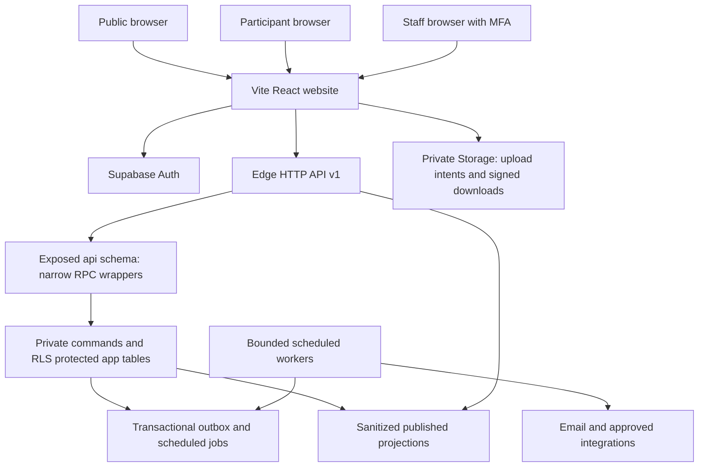

# Noesis 2.0 — System Architecture

Version: 0.1 proposed implementation contract  
Prepared: 10 November 2026  
Stack: Vite, React, TypeScript, Supabase Auth, PostgreSQL, Storage, Edge Functions  
Status: design only; no application, migrations, or infrastructure have been implemented or tested.

## 1. Scope and authority

Build one festival platform supporting public discovery, participant accounts, event registration, teams, submissions, staff operations, judging, results, and controlled offline work. The portal must execute routine checks automatically while preserving the approvals explicitly required by the supplied PRDs.

Sources of business requirements are the user's event schedule and pasted Registration, Sprintathon, Doomsday, Coding Arena, Stock Exchange, System Override, Results, Check-in, Sports, Performer, and Arcade PRDs. The inaccessible linked PRDs have not been independently read. Public website requirements are inferred from the supplied Main Plan and schedule, and are labeled proposals where necessary.

Normative terms: **MUST** is required by this specification; **PROPOSED** is an engineering recommendation awaiting adoption; **PENDING** is a business decision that the software must not invent. These documents specify an extensive baseline test catalog, not a claim that all conceivable failures are enumerable. Tests must grow when rules and implementation change.

Companion contracts:

- [DATABASE_SCHEMA.md](DATABASE_SCHEMA.md): entities, constraints, transactions, data tests.
- [API_SPECIFICATION.md](API_SPECIFICATION.md): transport, commands, payloads, error behavior.
- [AUTH_AND_RBAC.md](AUTH_AND_RBAC.md): identity, scoped permissions, RLS, security tests.

If documents conflict, stop the affected implementation and amend all four: business rules belong here; data invariants in the schema; wire behavior in the API; access rules in RBAC. Neither UI state nor a client-supplied status overrides any contract.

## 2. Event inventory and schedule

Festival dates are provisionally 28–29 January 2027, from the earlier Main Plan. Website registration launch is provisionally 26 November 2026. Both require organizer confirmation. Store timestamps as UTC `timestamptz`; display and enter schedules using `Asia/Kolkata`. A festival day is an explicit calendar record, not a 24-hour offset.

There are 14 distinct events and 15 supplied session rows. Doomsday is a Sprintathon-linked operational module, not an invented fifteenth competition.

| Slug | Display name | Supplied session (IST) | Venue | Delivery |
|---|---|---|---|---|
| sprintathon | Sprintathon | D1 09:00–12:00; D2 00:00–11:00 | Lecture Theatre + Classroom 3 | Team entry, online selection, final project, judging |
| algo-rumble | Algo Rumble | D1 11:00–15:00 | Classroom 2 | Judge integration, knockout bracket |
| vedam-stock-exchange | Vedam Stock Exchange | D1 11:00–14:00 | Stride | Onsite entry, virtual trading |
| fifa | FIFA | D1 11:00–18:00 | Hive | Roster, bracket, referee results |
| chess | Chess | D1 15:00–18:00 | Stride | Approved pairings and referee results |
| blackout | Blackout | D1 16:00–19:00 | Classroom 2 | Approved contest platform and visibility phases |
| rhythm-riot | Rhythm Riot | D1 16:00–19:00 | Ground | Performance entry, video/audio, stage list |
| concert | Concert | D1 19:00–21:00 | Ground | Public info; admissions only if approved |
| system-override | System Override | D2 10:00–18:00 | Stride | DSA import, bug fixes, feature challenge |
| pixel-playground | Pixel Playground | D2 10:00–16:00 | Hive | Public info; coupon/stock desk if approved |
| codeblitz | CodeBlitz | D2 11:00–15:00 | Classroom 2 | Approved judge; PRD contest time 13:00–15:00 |
| bgmi | BGMI | D2 11:00–19:00 | Lecture Theatre | Four active players, qualifier/final lobbies |
| no-time | No Time | D2 15:00–18:00 | Classroom 3 | Question rounds; timing/cuts pending |
| dj-night | DJ Night | D2 17:00–21:00 | Ground | Public info; admissions only if approved |

Represent reporting, competition, breaks, judging, and awards as distinct session kinds. One session may use multiple venues through a join table. Venue handover buffers and participant reporting overlaps are separate conflict checks. Detect overlaps using half-open intervals `[start,end)`, then add approved buffers.

### 2.1 Decision register — release gates

| ID | Decision / conflict | Accountable owner | Behavior until approved |
|---|---|---|---|
| DEC-01 | Final dates, launch date, exact signup/solution close times on 13/20 Jan | Festival lead | Display provisional dates; do not activate unresolved cutoffs |
| DEC-02 | Sprintathon continuous start/end; missing D1 noon–midnight; PRD 11 AM start | Sidhant + event lead | Block competition schedule publication and Doomsday activation |
| DEC-03 | CodeBlitz reporting 11 AM vs contest 1 PM | Coding lead | Keep reporting and contest windows unpublished separately |
| DEC-04 | No Time R1 3 vs 30 minutes; R2→R3 cut, ties, no-shows, languages | Setter + Sidhant | Block round activation, qualification, and final result calculation |
| DEC-05 | FIFA edition/settings/stations, BO1/BO3, draws/disconnect/no-show rules, cap | Arnav | 64 is a planning target, not a live cap |
| DEC-06 | BGMI room capacity, groups, maps, finalists, 5/6 final matches, cap, substitutes | Kanishk | 50 teams is a target; hide credentials; no unapproved substitute activation |
| DEC-07 | Event fees, refund policy, payment channel and verifier | Finance + festival lead | Payments disabled; no invented paid status |
| DEC-08 | Noesis Cup squads, locks, weights, eligibility, ties | Festival lead | Entire Cup module disabled |
| DEC-09 | Arcade coupon price, refunds, prize rules and stock authority | Preetam + finance | Information page only |
| DEC-10 | Admission policy for Concert/DJ; creator/guest passes and quantities | Festival + stage lead | No implied ticket entitlement or competition entry |
| DEC-11 | Sprintathon top 50/reserves, rubric, ties, confirmation expiry/promotion policy | Sprintathon lead | Score drafts permitted; no automatic selection/promotion |
| DEC-12 | Four Doomsday challenge rules, windows, attempts, rewards/penalties, reversals | Sidhant + marshals | Preview/test only; protect uploads, food/rest and connectivity |
| DEC-13 | Five Algo and two Override group effects and timings | Respective event leads | No activation; no individual challenge generated |
| DEC-14 | Override individual/team format, bug deduplication, weights, feature rubric | Preetam + mentors | No entry confirmation or live scoring until corresponding rules exist |
| DEC-15 | Chess format/ties; dance group limits/rubric/order; disputes cutoff | Respective leads | Only approved parts open |
| DEC-16 | Venue buffers, Lecture Theatre Sprintathon→BGMI handover, actual stations | Operations lead | Flag conflicts and require recorded resolution before publication |
| DEC-17 | Per-event eligibility/caps/roster locks; overlap exceptions and replacement policy | Event leads | Block confirmation when required rule is missing |
| DEC-18 | Storage limits, retention, consent text, public display names, export handling | Festival lead | Private by default; block uploads lacking approved limits/consent |
| DEC-19 | SMTP/provider, hosting plan, expected traffic, backup budget, offline devices | Technical + operations lead | No reliability/SLA claim until rehearsal verifies capacity |
| DEC-20 | Meaning of day/attendance eligibility overnight; pass re-entry and scan quantities | Operations lead | Use explicit festival-day assignment; reject ambiguous admissions |

The portal records proposal, approver, effective time, version, and reason. A changed approved rule creates a new version, validates existing entries, and produces an impact report. It must never silently invalidate confirmed teams or alter completed scoring.

## 3. Architecture and trust boundaries

Use a modular monolith in one repository and one Supabase project per environment. PROPOSED frontend helpers: React Router, TanStack Query, React Hook Form, Zod, and a shared accessible component system. Pin supported versions and commit the lockfile at implementation time; these are recommendations, not installed dependencies.



### 3.1 API decision

All business reads/writes use the versioned Edge HTTP gateway described in the API contract. It verifies the caller and invokes narrow PostgREST RPCs using the **same user's JWT**. It does not perform user operations with a service key.

Only `api` is exposed as the application Data API schema. `app` contains domain tables, `private` contains authorization helpers/privileged command implementations; neither is exposed. Read RPCs use invoker security and explicit projections over RLS-protected tables. Authenticated users have only required underlying SELECT privileges, never general business-table DML. Sensitive commands use reviewed private definer implementations with explicit actor, scope, state, deadline, and invariant checks. See RBAC for ownership/grant details.

A caller can invoke an exposed RPC without the Edge gateway. Therefore permission checks, quotas for state-changing commands, idempotency, and invariants MUST also exist at the database boundary. Edge rate limits/CORS are additional controls, not the security boundary. Direct Auth and Storage calls remain supported under their respective policies.

### 3.2 Module boundaries

| Module | Owns | Must not own |
|---|---|---|
| Identity/access | Profile linkage, live assignments, session restrictions | Competition scores |
| Festival catalog | Sessions, venues, rule versions, publishable content | Private contacts |
| Registration | Entries, capacity, consent, accepted roster, attribution | Attendance or finalist selection |
| Submissions | Stage drafts, versions, assets, freeze manifests | Final award publication |
| Reviews/selection | Assignments, rubric scores, decisions, reserves | Mutable project code |
| Competition operations | Rounds, matches, imports, stage scores, effects | Public winners without approval |
| Trading | Virtual ledger, market versions, final valuation | Real-money trading |
| Check-in/admissions | Per-person attendance, pass usage, offline reconciliation | Competition eligibility policy |
| Results | Approved result versions, disputes, stage handoff, optional Cup | Raw contact lists |
| Performer/arcade | Stage media/cues; conditional coupon and stock records | Generic administrative bypass |
| Operations | Audit, notifications, exports, jobs, monitoring | Rule approval on behalf of an organizer |

Owner names in PRDs route work and approval queues; they do not automatically grant access to any account with that display name.

### 3.3 Proposed repository layout

```text
src/
  app/                  # router, providers, session boundaries
  components/           # reusable accessible UI
  features/
    catalog/ identity/ registration/ teams/ submissions/
    sprintathon/ doomsday/ coding/ trading/ override/
    sports/ performers/ check-in/ results/ arcade/ administration/
  lib/                  # transport, validation, time, generated DB types
supabase/
  migrations/           # reviewed relational schema, grants, RLS, functions
  functions/            # HTTP gateway, webhooks, bounded workers
  tests/                # pgTAP, command and RLS/concurrency tests
tests/                  # API integration, browser journeys, load scenarios
```

## 4. Business workflows and invariants

### 4.1 Identity, registration, and teams

One verified Auth identity maps to one profile and participant code. An email-verification flow proves mailbox access, not uniqueness of a real-world person. Do not merge accounts by name/phone; suspected duplicates require audited resolution. Participation in multiple events reuses the profile.

Entry state: `draft → submitted → confirmed | waitlisted | rejected`; `submitted`, `waitlisted`, and `confirmed` can become `withdrawn`; staff may cancel with reason. PENDING policies may insert review/payment holds without conflating them with confirmation. Incomplete/unapproved rosters remain Draft. `submitted` means a complete roster awaiting checks/approval, not an incomplete entry.

Registration, payment, selection, submission, roster verification, and attendance are separate state dimensions. Event entry capacity uses approved units (people or teams); Sprintathon finalist quota is separate from signup capacity. Confirmations allocate capacity transactionally. Drafts do not reserve seats. A waitlist promotion rechecks all conditions and records authority; no blind auto-promotion.

Team invitations are hashed expiring tokens tied to a verified recipient, event, team, and membership role. Acceptance is explicit and atomic; an invitation never counts as consent. Sprintathon needs 3–5 accepted members. BGMI requires four active player records, each linked to an accepted person; substitutes remain inactive until approved. Replacements create a request and a new roster version. Frozen rosters and historical results remain unchanged.

Approved campaign/college/ambassador/creator codes are preserved as entry attribution snapshots. Unknown values map to Unattributed and remain separately diagnostic without allowing raw URLs to inject HTML. Export unique people separately from event entries and attendance.

### 4.2 Submissions, selection, and projects

Submission stage state: `draft → submitted → frozen`. Each submit creates an immutable version; review state is separate. Before cutoff, later submits create new versions and invalidate the applicability of earlier scores for selection. Review records still preserve the scored version and reviewer.

Sprintathon signup closes on 13 Jan; online solution closes on 20 Jan; top 50/reserves approved on 21 Jan; confirmation due 23 Jan subject to approval; final project closes **29 Jan 2027 at 11:00 IST** (`2027-01-29T05:30:00Z`). Exact times other than the final cutoff remain DEC-01/11. Registered eligible teams can submit solutions after signup closes. Top-50 selection requires exactly the approved eligible count or an explicitly approved shortfall.

Final submission requires code/project/deployment and demo video; README is recommended. Resolve a repository URL to an exact commit and archive the judged artifact when permitted. Store file hashes and a manifest. An editable branch URL or hosted video alone is not an immutable snapshot. Access-check external links with safe restrictions; preserve pending/broken status and require pre-judging resolution. Never execute submitted code in the production backend.

Allocate all eligible finalist projects to judges; track coverage and conflicts of interest. Judging completion, final approval around 17:00 D2, and stage delivery before approximately 20:00 are separate operational milestones. Publish approved arrival, food, rest, and return-for-awards instructions with delivery status.

### 4.3 Doomsday and contest effects

Only the current locked captain of a selected Sprintathon team may access its assignment. Four challenge types and four releases are configured separately. Proposed release instants: 28 Jan 16:00 and 21:00; 29 Jan 02:00 and 07:00 IST, gated by DEC-02/12. Persist assignment/version before reveal; refresh/reconnect cannot reroll it. Answer keys stay private.

Attempt count, answer cutoff, evaluation version, result receipt, effect start/expiry, and reversal are server records. Use a unique source key for each applied effect. A restart or repeated worker delivery must not duplicate rewards. Protected upload/submission, food/rest, and connectivity capabilities cannot be removed by an effect.

Algo has five approved bracket-transition group effects; System Override has two approved inter-stage group effects. These are marshaled bulk activations over frozen eligible recipients, not individual challenge assignments. Override's feature stage retains a full 90 minutes. Applied effect corrections append reversal records.

### 4.4 Coding and sports

Use approved external judge/platform integrations and mentor-tested problems. Do not build a code execution sandbox as part of this scope. Store platform handles and signed/verified score-import provenance. Handle changes need re-verification and cannot rewrite existing results.

- Algo: 64 entrants, six knockout rounds, 32 opening matches; four 10-minute rounds, approximately 20-minute semi and 25-minute final, plus approved breaks. One approved advancement per match; ties/no-shows need policy. Fewer entrants require approved seeding/byes rather than fabricated players.
- Blackout: R1 5 minutes visible/2 hidden; R2 5 visible/1 hidden; top 12 advance under approved ranking. Code remains intact. The judge/integration must demonstrably support visibility controls; otherwise flag this capability as a blocker, not a frontend-only promise.
- CodeBlitz: approved 29 Jan 13:00–15:00 contest subject to reporting reconciliation. Practice contest verifies languages, penalties, tests, ranking.
- No Time: 15/30/40 questions; R1 top 50% under approved rounding/tie policy. Do not resolve 3/30-minute ambiguity or later cutoffs in code.
- FIFA: proposed 64-player/63-match bracket; BO1/BO3 and station occupancy are configuration. Persist per-game scores as needed. Referee evidence and corrections remain traceable.
- BGMI: six qualifier matches; approved groups/maps/room capacity; separately version qualifier and finals scoring. Only assigned active squads see credentials during their access window. Announce and lock five or six finals matches before finals start.
- Chess: use approved pairings/rounds and draw/tie-break policy. Referees supply outcomes.

Unreviewed imports/results are provisional. Changing an upstream knockout result after downstream play creates an impact-resolution task and blocks contradictory publication.

### 4.5 Virtual trading and System Override

Stock Exchange entry is verified onsite 11:00–12:00; game runs 13:00–14:00 subject to schedule approval. No online pre-quiz. Desk-assisted participants must have a real verified account before wallet issuance; assisted signup must not create fake emails or shared accounts. Operational exceptions require a separately approved identity process.

One wallet per player/session; equal opening funds; integer quantities and exact decimal prices. Serialize market open/pause/close, price publication, and orders using the locking contract. An order accepted under a market version uses that version, never a mixture. Final valuation freezes closing prices and ledger cutoff. Real payment and virtual game balances are separate systems.

Override uses one locked roster across DSA, bugs, and feature stages. DSA results import for 11:00–13:00. The buggy site/repository runs on an isolated origin/environment with synthetic data and no production keys. Collect issue ID, reproduction, evidence, fix commit, verdict, and approved duplicate attribution. Freeze code at each cutoff; combine only approved versioned weights. The feature challenge is 90 minutes with explicit checks per required feature.

### 4.6 Attendance, results, media, and conditional modules

Attendance is per **person + event + festival day**, with actual scan time, staff, source, and evidence. Captain/roster verification is separate. QR contains an opaque identifier, never contacts; possession of a QR alone is not proof of identity. The desk checks accepted roster, eligibility, finalist status, and approved payment requirements. Online duplicates return the same receipt.

Offline exports are minimal, event/day/device-scoped, expiring, and private. Offline scans are provisional: two disconnected devices cannot globally prevent duplicates. On reconnect, immutable local operation IDs deduplicate transport; the server merges attendance with the global uniqueness rule and queues stale-eligibility conflicts. Do not promise offline trading, coupon redemption, or automatic exception approval.

Results: `draft → pending_approval → published`. Corrections create new versions and supersede the published pointer atomically. Public pages, participant results, and stage exports use the same approved version. Disputes require cutoff, evidence, reviewer, and disposition. Stage packages require acknowledgement; corrections create a replacement package and a new acknowledgement task.

Rhythm Riot entry, advance video, final audio, review, and attendance are separate records. Stage lists pin roster/order/cue/audio version. AV validates main and backup playback devices; approved offline packages include checksums and cue sheets. Dance awards and Concert/DJ cues must use approved stage handoffs, including the D1 19:00 handover.

Optional Cup membership is independent of event teams, opt-in, consented, and locked. For each squad/event, count the best eligible finish once under approved weights/ties. Optional Arcade uses single-use coupons, payment status, append-only stock movements, staff-reasoned void/refund, and reconciliation. Guest/creator passes never imply competition entry.

## 5. Automation, reliability, and recovery

### 5.1 Durable jobs

Commit domain state, audit, and an outbox record in the same transaction. Workers lease jobs in bounded batches, acknowledge after success, retry with backoff/jitter, and expose dead-letter/retry controls. Store provider message IDs and delivery events. At-least-once processing is assumed; external email may occasionally duplicate after an uncertain provider response. A deduplication key prevents duplicate business effects, not an absolute exactly-once claim for external delivery.

Use a recurring Cron dispatcher that finds due persisted jobs rather than browser timers or one long-running Edge invocation. Supabase offers Cron and durable Queues; start with the schema's database job/outbox tables, adding Queues as an implementation adapter only if needed. Edge workers have runtime limits, so scanning/transcoding/large archives need bounded jobs or an isolated worker service. [Cron](https://supabase.com/docs/guides/cron), [Queues](https://supabase.com/docs/guides/queues), [Edge limits](https://supabase.com/docs/guides/functions/limits)

Do not hold database locks while sending email, downloading repositories, scanning files, or talking to payment providers. Freeze manifest candidates first, perform external work, then finalize via a state/version checked command.

### 5.2 Frontend behavior

Show server receipt, current state, next action, server time, and last refresh time. Recover in-progress forms after reauthentication without silently submitting them. Clear private query caches on logout/account switch. Mobile-first desk flows must support keyboard lookup and explicit scan confirmation. Use accessible labels, error summaries, focus handling, keyboard navigation, and non-color-only status indicators. Target WCAG 2.2 AA as a proposed acceptance standard.

Realtime is optional invalidation, not the source of truth. Send identifiers/revision hints only; fetch authorized current state after reconnect. Private channels require their own policies, and existing subscriptions are not assumed to revoke instantly. Never broadcast PII, credentials, answers, or judge notes. [Realtime authorization](https://supabase.com/docs/guides/realtime/authorization)

### 5.3 Proposed service objectives — validate before promising

| Objective | Proposed rehearsal target |
|---|---|
| Capacity baseline | 5,000 participant profiles, 15,000 entries; test 1,000 browsing sessions and 100 concurrent mutations |
| Read / mutation latency | p95 < 1 s / < 2 s excluding provider/upload time, under agreed workload |
| Scheduled releases | Due within 60 s; alert if overdue by 120 s; server deadlines never depend on dispatcher timeliness |
| Data integrity | Zero over-cap confirmations, negative balances/stock, duplicate effect applications or attendance rows |
| Recovery | Proposed RPO ≤ 5 minutes and RTO ≤ 60 minutes only with funded, rehearsed backup setup |
| Event monitoring | Named on-call technical operator; alerts for failed jobs, DB pressure, stale market state, release lag, delivery failures |

These are engineering sizing assumptions, not supplied traffic forecasts or guarantees. Choose Supabase/hosting plans after load tests and confirmation of backups, auth email limits, storage and egress budgets. Record supported PostgreSQL and CLI versions. November 2026 CLI v3 changes default targets and hosted command confirmations; verify CLI help and environment selection in CI. [CLI change](https://supabase.com/changelog/supabase-cli-v3)

### 5.4 Recovery and deployment

Use separate local, staging, and production projects with synthetic staging data. Apply reviewed migrations through CI, generate DB types, check grants/RLS, run integration tests, and deploy backwards-compatible schema before clients. Destructive migrations need an export and tested recovery path. Roll back application releases without assuming irreversible data transitions can be reversed by old code.

Back up PostgreSQL **and Storage bytes separately**; database backups cover Storage metadata, not the uploaded objects. Preserve immutable project/media manifests, AV packages, configuration, and required provider settings. Rehearse restoring a staging copy and reconciling notifications/payments after point-in-time recovery. Pause workers and trading during restore; reconcile external facts before enabling retries. [Supabase backups](https://supabase.com/docs/guides/platform/backups)

Failures: provider outage leaves confirmations durable; database outage permits controlled provisional check-in only; trading and redemptions fail closed; external judge outage invokes an approved contest fallback; auth outage does not justify shared staff accounts. Any deadline extension is an approved versioned rule change with visible notices, never a hidden client grace period.

## 6. Delivery sequence and gates

| Phase | Ship | Exit gate |
|---|---|---|
| 0 | Decision register, rule versions, schema, permissions, infrastructure sizing | Open decisions have owners; no unresolved rule is hardcoded |
| 1 | Catalog, verified accounts, teams, registration, capacity, receipts, staff entry list | Complete Sprintathon registration journey plus race/RLS tests |
| 2 | Online solutions, dance assets, review assignments, notifications | Version/re-review, upload, cutoff tests pass |
| 3 | Selection, reserves, check-in, sports/coding import, results | Eligibility and approval bypass tests pass |
| 4 | Trading, Override, Doomsday | Ledger concurrency, four-wave restart rehearsal, isolation tests pass |
| 5 | Approved optional modules | Feature gates and finance reconciliation pass |
| 6 | Full rehearsal, offline/restore/load drill, stage/AV handoffs | Leads accept runbooks; no critical known issue; fallback owners assigned |

Registration launch does not require every January operations screen to be complete. It does require working authorization, receipts, constraints, audit, and truthful public rules. No module is accepted based only on screenshots or frontend mock data.

## 7. Business acceptance and edge-case catalog

Each row defines a test family. Implement it with happy-path, rejection, retry, permission, and concurrent variants where applicable. `P0` families block the affected release; operational requirements may need witnessed rehearsal evidence rather than an automated test. Database, API, and authorization catalogs add technical cases. Fixtures and execution approach are in section 8.

### 7.1 Catalog and registration (REG)

| ID | Scenario / action | Expected result |
|---|---|---|
| REG-01 | Import supplied festival schedule | 14 events, 15 sessions; Sprintathon keeps one identity |
| REG-02 | Publish unresolved schedule or unapproved optional feature | Affected publication blocked; decision ID shown to authorized staff |
| REG-03 | Login again / register second event | Same participant profile/code; independent entry |
| REG-04 | Missing name/email/phone/college/required consent | Clear field errors; no confirmed entry |
| REG-05 | Participant refuses new rule version | Existing consent retained; new required action explained; no fabricated acceptance |
| REG-06 | Event-specific fields | Algo requires both handles; FIFA platform/tag; BGMI four active IDs/IGNs; Sprintathon approved extras |
| REG-07 | Invite, accept, decline, expire, revoke | Only accepted members count; captain sees action status without private unrelated data |
| REG-08 | Sprintathon rosters of 2,3,5,6 accepted people | Only 3–5 can submit/confirm |
| REG-09 | BGMI three/four/five active players or unapproved substitute | Exactly four approved active members; incomplete entry stays Draft |
| REG-10 | Duplicate entry / member accepts two same-event teams | Database rejects competing active membership/entry |
| REG-11 | 100 requests for last capacity slot | Exactly one confirmation; others waitlist/reject under policy |
| REG-12 | Email fails after confirm / refresh receipt | Entry durable and visible; retry queued without new registration |
| REG-13 | Fees disabled / screenshot offered as paid proof | No payment collection; proof alone never sets verified paid |
| REG-14 | Approved fee/payment/refund flow | Correct event/amount/currency; verified state and reasoned refund history |
| REG-15 | Staff filters/export | Only assigned-event rows/allowed fields; private export audited |
| REG-16 | Approved source link, unknown code, no code | Snapshot correct attribution; unknown/missing Unattributed |
| REG-17 | Same person in 3 events, 2 days | Reports distinguish 1 person, 3 entries, actual daily/event check-ins |
| REG-18 | Overlap reporting/contest; adjacent sessions; venue buffer | Conflict engine applies approved intervals and recorded exception policy |
| REG-19 | Withdraw and replace before/after lock | Capacity released once; replacement rechecks consent/eligibility; locked history preserved |
| REG-20 | Captain leaves/transfers; pending invites; last member leaves | Explicit valid successor or blocked action; never orphan a submitted team |
| REG-21 | Organizer lowers cap below confirmed count | No silent cancellation; block or require approved remediation |
| REG-22 | Email/account change during invitation or registration | Reverify ownership; identity remains same; no invite hijack |

### 7.2 Sprintathon (SPR)

| ID | Scenario / action | Expected result |
|---|---|---|
| SPR-01 | Publish launch problem and submit solution | Approved problem ID, approach and asset/link; registration/solution states separate |
| SPR-02 | Signup closed, solution window still open | Registered eligible team edits solution; new signup rejected |
| SPR-03 | Review v1, team submits v2 | v1 score retained; v2 queued and selection cannot use stale v1 score |
| SPR-04 | Select top 50 plus reserves | Approved rubric/ties/current versions; quota enforced transactionally |
| SPR-05 | Fewer eligible submissions than quota / cutoff tie | Explicit approved shortfall/tie resolution; no arbitrary choice |
| SPR-06 | Confirm attendance; decline; expiry; reserve promotion | Traceable decisions and notices; no two teams promoted into one slot |
| SPR-07 | Missing code/video, broken/private link, missing optional README | Required assets block finalization; README absence alone does not |
| SPR-08 | Submit just before/at/after final cutoff | Before accepted only when required freeze work ready; at/after rejected under half-open deadline |
| SPR-09 | Change repository branch/video after freeze | Judges read pinned archived version; live link change does not replace it |
| SPR-10 | Judge allocation for 50 projects; conflicting judge | Full approved coverage; conflicts prevent assignment/review |
| SPR-11 | Finalists access captain challenge | Only selected team's current locked captain gains access |
| SPR-12 | Arrival/food/rest/awards notice delivery failure | Dashboard instruction remains; failures and retries visible |
| SPR-13 | Winners ready for stage around 17:00 D2 | Approved version exported and acknowledged before awards; lag alerts |

### 7.3 Doomsday and group effects (DOOM)

| ID | Scenario / action | Expected result |
|---|---|---|
| DOOM-01 | Noncaptain/unselected/other team accesses challenge | Denied without leaking prompt or answer |
| DOOM-02 | Four types/four scheduled releases including midnight | Correct persisted version appears at approved IST instant |
| DOOM-03 | Refresh/reconnect / two devices | Same assignment; shared server attempt count |
| DOOM-04 | Wrong/correct/repeated/late answers | Approved evaluator, limits and server cutoff; stable receipt |
| DOOM-05 | Submit twice concurrently on final attempt | At most one attempt consumes that remaining allowance |
| DOOM-06 | Worker restarts before/after reward commit | One assignment/effect; recover missed due work |
| DOOM-07 | Effect expires, staff reverses, reversal retried | One applied state and traceable reversal; no double compensation |
| DOOM-08 | Proposed penalty disables upload/network/rest | Configuration rejected; protected capabilities remain available |
| DOOM-09 | Five Algo/two Override bulk transitions | Marshal-approved recipient snapshot and one activation per transition; no individual questions |
| DOOM-10 | Delayed worker and staff fallback overlap | Same unique source; one application with audit |

### 7.4 Coding Arena (CODE)

| ID | Scenario / action | Expected result |
|---|---|---|
| CODE-01 | Import tested platform results/handles | Verified entrants, provenance and immutable source file; unknown handles quarantined |
| CODE-02 | Algo full bracket | 64 entrants, 32 opening matches, 6 rounds, 63 total matches; one winner each |
| CODE-03 | Ties/no-shows/fewer entrants/disqualification | Approved rules or blocked advancement; no invented result |
| CODE-04 | Round timers and breaks | Four 10-minute rounds, approved semi/final timings; server-controlled transitions |
| CODE-05 | Blackout visibility phases and reload | Correct 5/2 and 5/1 cycles; code intact; approved platform enforces phases |
| CODE-06 | Blackout top-12 tie or fewer valid finishers | Approved tie/shortfall rule; cutoff preview before approval |
| CODE-07 | CodeBlitz practice contest | Languages, tests, penalties, ranking and actual contest window validated |
| CODE-08 | No Time question counts and first cut | 15/30/40 configured; 50% uses approved rounding/ties |
| CODE-09 | Unresolved No Time timing/later cut | Cannot start relevant round or finalize qualification |
| CODE-10 | Device clock changes; reconnect; staff repeated start/close | No extra time; idempotent controls; submission records preserved |
| CODE-11 | Result correction after next bracket match starts | Impact resolution required; inconsistent winners cannot publish |
| CODE-12 | Raw score present but no event-lead approval | No final public winner or MC handoff |

### 7.5 Stock Exchange (TRADE)

| ID | Scenario / action | Expected result |
|---|---|---|
| TRADE-01 | Desk entry 11–12; repeat wallet issue/session reopen | One verified entry and equal opening wallet; no pre-quiz |
| TRADE-02 | Buy/sell valid, insufficient cash/holdings, zero/negative/fractional quantity | Valid exact ledger mutation; invalid order rejected atomically |
| TRADE-03 | Duplicate request and unknown response after commit | One trade and original receipt on retry |
| TRADE-04 | Concurrent spending/selling | No negative cash/holdings or oversell |
| TRADE-05 | Publish prices/news while orders arrive | Each accepted trade references one committed market version |
| TRADE-06 | Pause/close racing an order | Deterministic lock order and post-lock cutoff check; closed orders rejected |
| TRADE-07 | Portfolio and final valuation | Cash + holdings × frozen close price matches saved ledger |
| TRADE-08 | Missing closing price, tie, invalid imported score | Finalization blocked pending approved correction/rule |
| TRADE-09 | One-hour rehearsal with reconnect and last-second orders | Integrity preserved; approved winners exported only after review |

### 7.6 System Override (OVR)

| ID | Scenario / action | Expected result |
|---|---|---|
| OVR-01 | Change roster between stages | Denied after lock unless audited approved replacement policy applies |
| OVR-02 | DSA 11–13 import | Correct entry mapping, mentor approval and source proof |
| OVR-03 | Inspect buggy environment | Synthetic data, separate origin/credentials, no production access |
| OVR-04 | Bug report with missing repro/evidence/fix; duplicates | Field checks; linked verdict and approved duplicate attribution |
| OVR-05 | Feature starter PRD, rubric, 90-minute stage | Each requirement has scoring evidence; full stage duration preserved |
| OVR-06 | Late commit/repository mutation | Only frozen submitted code evaluated |
| OVR-07 | Two stage effects, replay or premature activation | Approved transitions only; one effect source each |
| OVR-08 | Combine weights / missing review / tie | Reproducible approved total; incomplete/unapproved data blocks publication |

### 7.7 Results and Cup (RES)

| ID | Scenario / action | Expected result |
|---|---|---|
| RES-01 | Result references unknown entry or invalid roster | Rejected; proof and valid entry required |
| RES-02 | Draft, pending, approved result through public API | Only published projection visible with last-updated time |
| RES-03 | Participant/team views results | Correct accepted historical roster; contacts/notes omitted |
| RES-04 | Dispute before/at/after cutoff | Before accepted; at/after rejected; reviewer/outcome/history retained |
| RES-05 | Concurrent correction publication | One current pointer; previous approved version retained |
| RES-06 | Stage export then result correction | New version/package and acknowledgement; public/stage revision identifiable |
| RES-07 | Cup disabled/unconsented affiliation | No enrollment, points, or public standings |
| RES-08 | Cup team different from event team; affiliation lock | Independent consenting roster; post-lock edits controlled |
| RES-09 | Multiple squad members place in same event | Best valid finish counted once under approved policy |
| RES-10 | Cup ties, disqualification, corrected event results | Versioned recomputation with breakdown and approved tie rules |
| RES-11 | Winner/prize export delivered to MC | Only approved names/placements/categories; receipt acknowledged |

### 7.8 Check-in and admissions (CHK)

| ID | Scenario / action | Expected result |
|---|---|---|
| CHK-01 | Staff scans QR/searches ID in assigned/unassigned event | Authorized minimal lookup only; QR contains no PII |
| CHK-02 | Unselected finalist/unaccepted member/unverified required payment | Admission denied or routed to permitted reasoned exception |
| CHK-03 | Captain scan / four BGMI player scans | Captain verification separate; attendance increments only actual people |
| CHK-04 | Same person twice, different day, different event | Duplicate same key returns receipt; legitimate separate keys accepted |
| CHK-05 | Manual exception and subsequent correction | Named authorized staff, evidence/reason, immutable history |
| CHK-06 | Offline export and outage | Minimal scoped expiring roster; provisional scans with local operation IDs |
| CHK-07 | Offline duplicate batches/two devices/stale cancelled entry | Merge once, preserve evidence, quarantine eligibility conflicts |
| CHK-08 | Report one person across both days/multiple events | Festival unique, daily unique, and event attendance totals separate |
| CHK-09 | Guest/creator pass invalid day, expired, excess quantity, re-entry | Enforce approved admission policy; no competition entry created |
| CHK-10 | Overnight scan near midnight | Explicit approved festival-day mapping; UTC/IST boundary tested |

### 7.9 Sports, performers, arcade (SPORT / PERF / ARC)

| ID | Scenario / action | Expected result |
|---|---|---|
| SPORT-01 | FIFA/BGMI registrations | Approved extra fields; target caps do not become policy accidentally |
| SPORT-02 | FIFA stations/BO1/BO3/disconnect/draw/no-show | Only approved settings publish; no simultaneous station overbooking |
| SPORT-03 | BGMI six qualifiers/group slots | Approved room capacity respected; qualifier and final standings separated |
| SPORT-04 | Outsider/another squad accesses room credentials | Denied; authorized squad only in configured access window |
| SPORT-05 | BGMI placement/eliminations/evidence/verification | Provisional then verified; impossible duplicate placements flagged |
| SPORT-06 | Finals start before 5/6 match count announced | Blocked until approved count locked |
| SPORT-07 | Chess draws/pairings/tie-breaks | Chosen approved format only; referee changes audited |
| SPORT-08 | Referee correction and final handoff | Evidence retained; only approved placements reach Results |
| PERF-01 | Solo/group entry, video and audio independent | One performance entry; separate required-stage receipts |
| PERF-02 | Pending/changes needed/approved review | Performer sees status and own comments; public cannot read comments |
| PERF-03 | New audio after AV acknowledgement | New version invalidates readiness; requires new playback checks |
| PERF-04 | Stage order/cue/roster/check-in | Correct matching audio and pinned roster; all required receipts verified |
| PERF-05 | Main/backup playback offline | Checksums, cue labels and actual playback verified on both devices |
| PERF-06 | Dance winners and 19:00 Concert handover; DJ cues | Approved version and explicit stage acknowledgement |
| ARC-01 | Public Pixel Playground page | Correct name, D2 10–16 window; transactional controls disabled until approval |
| ARC-02 | Issue coupon with approved price/payment | Unique coupon, traceable issuer and payment state |
| ARC-03 | Two scans redeem same coupon | One successful redemption |
| ARC-04 | Last prize issued concurrently | Stock never negative; issuance and redemption atomic |
| ARC-05 | Void/refund before/after redemption | Approved rule/role/reason; refunded coupon cannot redeem; no implicit prize restock |
| ARC-06 | End-of-day totals/export | Issued/redeemed/refunded/unused and sales/stock reconcile |

### 7.10 Operational and interface rehearsals (OPS)

| ID | Scenario / action | Expected result |
|---|---|---|
| OPS-01 | Keyboard-only/screen-reader registration and error correction | Labels, focus, error summary and confirmation usable without pointer/color |
| OPS-02 | Mobile slow network, refresh after submit, two tabs editing | Durable receipt or explicit draft conflict; no false success or duplicate entry |
| OPS-03 | Server/database outage during market/redemption | Fail closed; operators see incident status, no optimistic financial success |
| OPS-04 | Restore database and independent Storage backup | Frozen assets verify against manifest; provider side effects reconciled before workers restart |
| OPS-05 | Scheduled worker delayed/stopped through midnight | Deadlines still enforced synchronously; due waves recover once; lag alert delivered |
| OPS-06 | Public result correction with cached stage screen | Version/timestamp visible; refresh retrieves same current approved source |
| OPS-07 | Full-sized bracket, 50 projects, agreed load target | Integrity holds; latency/connection/egress measurements inform actual hosting plan |
| OPS-08 | Notification provider quota/outage | Dashboard remains authoritative; retries/dead-letter and operator action visible |
| OPS-09 | Deploy backwards-compatible change while participants active | Existing clients remain correct; rollback does not erase committed entries |
| OPS-10 | Deadline extension after disruption | Authorized versioned change, impact review, notices; original timestamps/history retained |

## 8. Test execution, traceability, and release evidence

### 8.1 PRD traceability index

| Supplied area | Main implementation records | API registry | Acceptance families |
|---|---|---|---|
| Website/event information | events, sessions, venues, rule versions, announcements | Catalog/administration | REG-01–02, REG-18, OPS-01–02 |
| Registration | profiles, contacts, entries, members, invitations, pools, consents, attribution | Entries/rosters/payments | REG-03–22 |
| Sprintathon | stages, submissions/versions/manifests, reviews, selection, confirmations | Upload/review/finalist | SPR-01–13 |
| Doomsday | variants, waves, assignments, attempts, effect activations/reversals | Doomsday/effects | DOOM-01–10 |
| Coding Arena | integrations, rounds, score imports, matches/bracket edges | Coding/round controls | CODE-01–12 |
| Stock Exchange | players, wallets, quotes, orders, trades, ledger, valuations | Virtual trading | TRADE-01–09 |
| System Override | locked rosters, stages/scores, bug reports, frozen manifests, feature checks | Override/competition | OVR-01–08 |
| Results/Cup | result sets/versions/projections, disputes, Cup snapshots/points, handoffs | Results/Cup/exports | RES-01–11 |
| Check-in | person/day/event attendance, exceptions, offline batches, passes | Check-in/admissions | CHK-01–10 |
| Sports console | match results, stations, lobbies, BGMI scores, private credentials | Sports registry | SPORT-01–08 |
| Performer portal | performances, submission assets, stage slots, packages, playback checks | Performer/stage | PERF-01–06 |
| Arcade | coupons, redemption, stock movements, payment/refund references | Arcade registry | ARC-01–06 |
| Cross-cutting reliability | audit, command receipts, jobs/outbox, exports, auth grants | Common transport and operations | OPS-01–10, all DB/API/AUTH suites |

### 8.2 Execution and evidence

Every PRD feature must map to at least one catalog family above and its technical cases in companion files. Maintain the same IDs in future test names. All families are unexecuted design specifications today. P0 includes authorization, capacity, immutable submissions, financial/virtual-ledger integrity, releases, attendance identity, and draft-result isolation. Conditional families become release blockers when their module is enabled.

Fixture set: two festival editions; all 14 events; participant P1/P2; shared team and opposing team; minimum/maximum/incomplete rosters; assigned/unassigned staff; expired grant; conflicting judge; unknown handle; selected/reserve/rejected teams; same event on two days; approved/unapproved rule versions. Generate enough entries for full 64-player brackets, 50 projects and representative BGMI groups.

Execution layers:

1. Unit: rule validation, exact decimal valuation, tie policy, overlap detection, state transitions.
2. Database: pgTAP/SQL assertions with real roles; constraints, RLS, transactions and immutable records.
3. Concurrency: separate database connections with barriers and injected pauses; do not simulate races sequentially.
4. API integration: real staging Auth, RPC and Storage; retry, provider stub, forbidden-path tests.
5. Browser: participant mobile flows, desk scanners, accessible forms, interrupted network, two accounts/tabs.
6. Rehearsal: four overnight waves, one-hour market, judge import, AV playback, offline merge, restore, stage acknowledgement.

Test deadline at `T−1 ms`, `T`, `T+1 ms`, and after waiting for a database lock across `T`. Test policy/version changes while actions are pending. Inject failure before commit, after commit before response, and after external provider acceptance before acknowledgement. Use property-based/randomized operation sequences to assert no negative stock/balance, no duplicated capacity allocation, and no public draft leakage.

An execution record needs commit/version, environment, fixture/rule version, test ID, expected/actual outcome, evidence, owner and unresolved defects. Passing documentation checks is not passing application tests. Update this catalog after incident reviews.

## 9. Research references and implementation cautions

Research checked 10 November 2026. Platform behavior is version-sensitive; verify again when implementing.

- [PostgreSQL transaction isolation](https://www.postgresql.org/docs/current/transaction-iso.html) and [explicit locking](https://www.postgresql.org/docs/current/explicit-locking.html): basis for deliberate transaction and retry boundaries.
- [Supabase database functions](https://supabase.com/docs/guides/database/functions): RPC execution and invoker/definer distinction.
- [Supabase RLS](https://supabase.com/docs/guides/database/postgres/row-level-security): defense at the data boundary.
- [OWASP authorization](https://cheatsheetseries.owasp.org/cheatsheets/Authorization_Cheat_Sheet.html): deny-by-default and per-request access checks.
- [OWASP file uploads](https://cheatsheetseries.owasp.org/cheatsheets/File_Upload_Cheat_Sheet.html): validated file handling and isolated processing.
- [Supabase PostgreSQL upgrade notice](https://supabase.com/changelog/postgres-15-19-17-11-breaking-changes): recheck extension/index compatibility when selecting/upgrading the database version.

No hosting plan, external judge capability, payment provider, SMTP provider, scanning worker, or institutional policy has been purchased, connected, or approved by writing this document.
